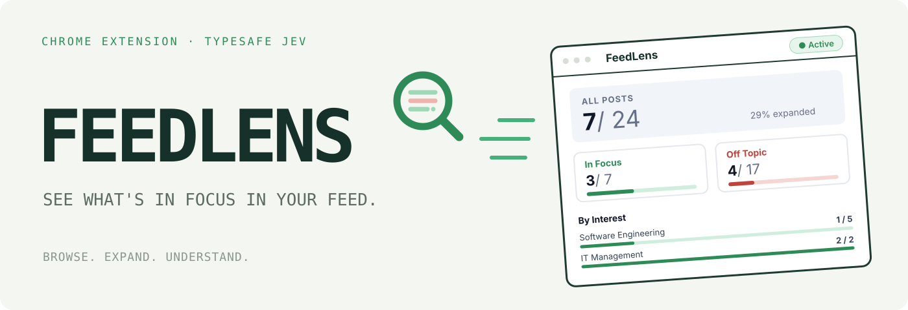
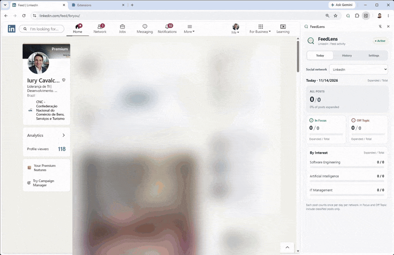
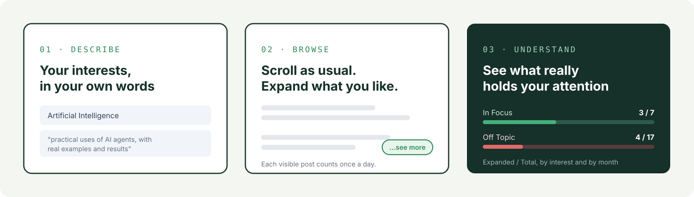
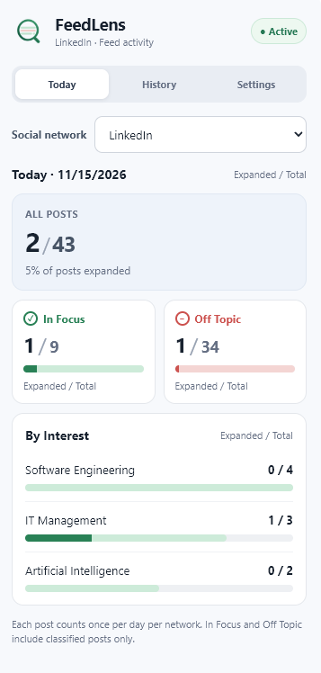
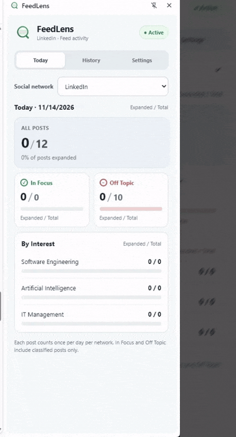
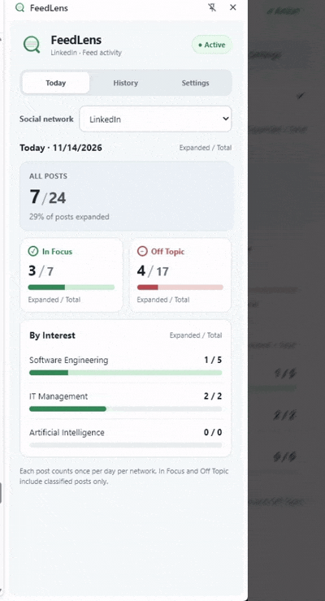
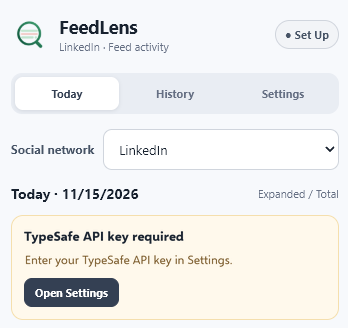
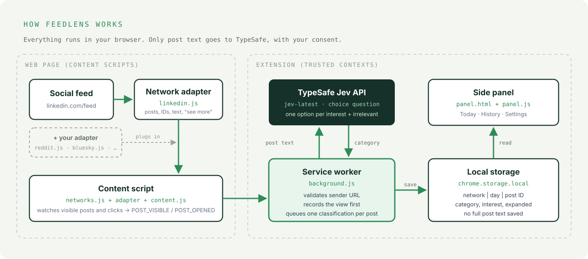
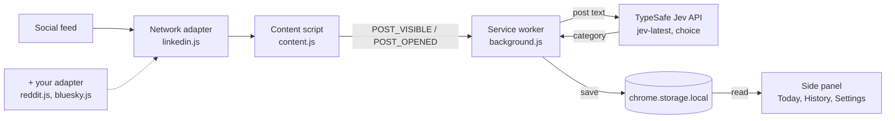

> [!NOTE]
> **LinkedIn is supported today, and FeedLens is built for more.** Every social network plugs in through a small adapter. Want Reddit, Bluesky, or Mastodon? [Add a network](#add-a-network-adapter).

# FeedLens 🔎

> [!IMPORTANT]
> **Ready to try it?** Load the extension in Chrome, add your TypeSafe API key and one interest, and open your feed.
> **[Quick start](#quick-start)** · **[Watch the demo](https://youtu.be/PUE5HCqVQJ4)**

**See how much of your social feed actually matches your interests.**

FeedLens is a Chrome extension that tracks the posts you see and the posts you expand as you browse. Describe your interests in your own words, and [TypeSafe's Jev](https://docs.typesafe.ai/introduction) classifies each post as **In Focus** or **Off Topic**. A side panel shows today's activity, a monthly history, and a breakdown by interest.

**No build step. No server. No database.** Your history stays in `chrome.storage.local`, on your machine.

<a href="https://youtu.be/PUE5HCqVQJ4"></a>

[Watch the demo](https://youtu.be/PUE5HCqVQJ4) · [Quick start](#quick-start) · [Architecture](#architecture) · [Add a network](#add-a-network-adapter)

<sub>Other people's posts are blurred in the recordings. Only the FeedLens panel and the author's own profile are shown.</sub>

## How it works



1. **Describe.** Add interests with a name and a short description, like *Artificial Intelligence: practical uses of AI agents, with real examples and results.*
2. **Browse.** Scroll your feed as usual. Each visible post counts once per day. Click **see more** and the post counts as expanded. FeedLens never changes the feed.
3. **Understand.** Jev picks the best matching interest for each post, or marks it Off Topic. The panel shows **Expanded / Total** for everything.

## Quick start

You need **Chrome 116 or later**, an internet connection, and a **TypeSafe API key**.

```text
1. Download or clone this repository (extract the ZIP if needed).
2. Open chrome://extensions, turn on Developer mode, click Load unpacked.
3. Select the folder that contains manifest.json.
4. Click the FeedLens toolbar icon to open the side panel.
5. In Settings: add at least one interest, paste your TypeSafe API key,
   read the notice about sending post text to TypeSafe, click Save Settings.
6. Check that LinkedIn is enabled under Monitored Networks.
7. Open or refresh https://www.linkedin.com/feed/ and browse as usual.
```


> [!TIP]
> **Upgrading?** Replace the files in the folder Chrome already uses, click **Reload** on the extension card, and refresh the LinkedIn tab. Loading a different folder can give the extension a new ID and a separate storage area, which hides your old history.

## The side panel

<table>
<tr>
<td width="33%" valign="top" align="center"><br /><sub><b>Today</b></sub></td>
<td width="33%" valign="top" align="center"><br /><sub><b>Live counters</b></sub></td>
<td width="33%" valign="top" align="center"><br /><sub><b>History</b></sub></td>
</tr>
</table>

**Today**: every post viewed today, the **In Focus** and **Off Topic** totals, and a breakdown **By Interest**.

**History**: monthly totals and a daily chart for the month you pick. Green is In Focus, red is Off Topic, and darker segments are the posts you expanded.

**Settings**: your TypeSafe API key, monitored networks, and interests. **Delete All Data** asks for confirmation, then clears history, interests, the key, and local preferences.

The **network filter** lists every registered network plus **All networks**, so results combine as more adapters arrive.

The status button in the header opens Settings:

| Status | Meaning |
| --- | --- |
| **Set Up** | The TypeSafe API key or an interest is missing. |
| **Paused** | Monitoring is disabled for the selected network. |
| **Active** | Capture is enabled. API responses are handled separately. |



## Architecture



The **adapter** knows one network's markup: how to find posts, their IDs and text, and the **see more** control. The shared **content script** reports when a post appears on screen and when you expand it. The **service worker** checks the sender's real URL, **records the view before calling Jev** so All Posts updates right away, then queues one classification per post. The **side panel** reads saved results for the selected network and date range.

<details>
<summary>Same diagram in Mermaid</summary>



</details>

## What gets counted

| Metric | Definition |
| --- | --- |
| **All Posts** | Each viewed post, once per day per network. |
| **In Focus** | Posts Jev matched to one of your saved interests. |
| **Off Topic** | Posts Jev classified without a match. |
| **Expanded** | Posts where you clicked the text expansion control. Repeat clicks on the same post that day count once. |
| **By Interest** | Each In Focus post, under its primary interest. |

Posts still waiting for classification, posts with too little text (under 30 characters), and failed API calls still count under **All Posts**. That is why In Focus plus Off Topic can be lower than All Posts.

Each record is keyed by **network, local date, and post ID**. Records from earlier versions without a network are treated as LinkedIn records.

```json
{
  "network": "linkedin",
  "day": "2026-11-14",
  "id": "urn:li:activity:123",
  "status": "done",
  "category": "relevant",
  "interest": "Technology",
  "opened": true,
  "firstSeenAt": "2026-11-14T13:00:00.000Z",
  "openedAt": "2026-11-14T13:01:00.000Z",
  "classifiedAt": "2026-11-14T13:01:02.000Z"
}
```

## Privacy by design

- **Local first.** History lives in `chrome.storage.local`, restricted to trusted extension contexts. There is no FeedLens server.
- **Only what classification needs.** Visible post text goes to TypeSafe for classification. The full text is not saved in history, only IDs, classifications, expansion status, and timestamps.
- **Your key, your consent.** Saving a TypeSafe API key authorizes FeedLens to send post text to TypeSafe. Classification starts only after a key and at least one interest are saved and the network is enabled.
- **Read only.** FeedLens reads rendered text and observes your clicks. It does not capture images or video, and it does not automate anything on the page.
- **Verified senders.** The service worker checks each event's actual page URL against the network registry before accepting it.
- **Delete everything.** One button clears history, interests, the key, and preferences.

Under the hood, the service worker sends a POST request to `https://api.typesafe.ai/v1/systemone` with the `jev-latest` model and a [`choice` question](https://docs.typesafe.ai/primitives/choice): one option per interest (up to 20), plus `irrelevant`. Post text is capped at 3,500 characters, and posts under 30 characters are counted but not classified.

> [!WARNING]
> API calls may incur charges on your TypeSafe account. Changing your interests applies to future classifications only. Post text may contain personal data, so avoid using FeedLens with confidential material. Keep your TypeSafe API key out of source code.

## Small enough to read

| File | Job |
| --- | --- |
| [manifest.json](manifest.json) | Permissions, the side panel, and where content scripts are injected |
| [networks.js](networks.js) | Registry of supported networks and domains; builds record keys |
| [linkedin.js](linkedin.js) | LinkedIn adapter: posts, identifiers, text, expansion controls |
| [content.js](content.js) | Observes visible posts and user clicks, sends standard events |
| [background.js](background.js) | Validates event sources, records posts, calls Jev, saves results |
| [panel.html](panel.html) | Side panel layout and styles |
| [panel.js](panel.js) | Filters and displays counts, manages settings |

Plain JavaScript on Manifest V3. Permissions: `storage` and `sidePanel`. Host permission: `https://api.typesafe.ai/*`. Content scripts run only on `linkedin.com`.

## Add a network adapter

An adapter is one file that implements six methods for the shared content script. Use [linkedin.js](linkedin.js) as the reference.

```javascript
const feedlensAdapter = {
  network: "example-network",
  isFeedPage() { /* Return true on the supported feed. */ },
  findPosts() { /* Return the post elements. */ },
  getPostId(element) { /* Return a stable identifier or null. */ },
  getPostText(element) { /* Return the post text. */ },
  findPostForButton(button) { /* Return the post containing the button. */ },
  isExpandButton(button) { /* Return true for a text expansion control. */ }
};
```

1. Create an adapter such as `reddit.js` that implements the methods above.
2. Register the network and its HTTPS domains in [networks.js](networks.js).
3. Add a `content_scripts` entry in [manifest.json](manifest.json) that loads `networks.js`, the new adapter, and `content.js`, **in that order**, for the right URLs.
4. Add any permissions the network requires.
5. Test post detection, scrolling, and expansion clicks, and review the platform's terms.

The panel builds its network options from the registry, so a registered network shows up in the filter automatically.

### Networks

| Status | Network | Contributor |
| :---: | --- | --- |
| ✅ | LinkedIn | [Iury Cavalcante](https://github.com/IuryCavalcante) |
| | Reddit | *open* |
| | Bluesky | *open* |
| | Mastodon | *open* |
| | Threads | *open* |
| | X | *open* |
| | Facebook | *open* |
| | Instagram | *open* |
| | Tumblr | *open* |
| | Pinterest | *open* |

**Contributions are welcome.** Pick a network, build its adapter, and open a pull request.

## Testing checklist

1. Chrome loads the extension without errors.
2. Save a key and an interest. Disable LinkedIn under **Monitored Networks** and confirm capture stops. Enable it again.
3. Scroll the feed and check **All Posts**, **In Focus**, **Off Topic**, and **By Interest**.
4. Expand a post and confirm **Expanded** increases once for that post on that day.
5. With the API unavailable, the post still counts under **All Posts** while classification totals stay the same.
6. In **History**, switch between **LinkedIn** and **All networks** and check daily and monthly totals.
7. After updating an earlier installation, old history still appears under LinkedIn.
8. The network filter is hidden in **Settings**, and **Delete All Data** clears history, interests, the key, and preferences after confirmation.

## Limits

FeedLens relies on each network's HTML to find posts and expansion controls, so a markup change can break capture until the adapter is updated. If counters stay at zero after reloading the extension, refresh the feed tab. Reading rendered posts automatically may conflict with a platform's rules on extensions; review them before using or adding an adapter. FeedLens tracks topic matches; it does not detect AI-generated content.

## License

[MIT](LICENSE) © Iury Cavalcante

---

[TypeSafe Jev](https://docs.typesafe.ai/introduction) · [Choice primitive](https://docs.typesafe.ai/primitives/choice) · [Chrome side panel API](https://developer.chrome.com/docs/extensions/reference/api/sidePanel)
